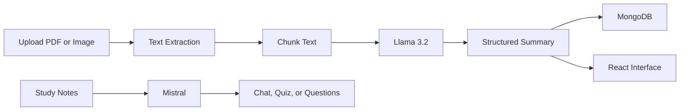

```markdown
# EasyLearn

<div align="center">


### Turn PDFs and handwritten notes into ready-to-study content

Upload documents, extract knowledge, and review it with summaries, flashcards, quizzes, exam questions, and an AI tutor.

**[Live Demo](https://easy-learn-beta.vercel.app)** · **[Backend API](http://localhost:8000/docs)** · **[Quick Start](#quick-start)**

[](https://react.dev/)
[](https://fastapi.tiangolo.com/)
[](https://www.mongodb.com/)
[](https://ollama.com/)
[](https://github.com/tesseract-ocr/tesseract)

</div>

---

## What EasyLearn Does

EasyLearn converts study materials into an organized learning experience:

| Upload | Understand | Practice | Review |
|:---:|:---:|:---:|:---:|
| PDF, images, scans, and handwritten notes | AI summaries and key concepts | Quizzes and exam questions | Flashcards and chat |

---

## Features

### Document to Study Material

- Upload multiple PDFs or images at once
- Extract PDF text with `pdfplumber`
- Read images and handwritten notes with Tesseract OCR
- Generate a structured summary, key concepts, explanation, exam tips, and quick highlights
- Export the final summary as a formatted PDF
- Save summaries to MongoDB for later review

### Ducky AI Tutor

- Chat about uploaded notes or ask general study questions
- Generate multiple-choice quizzes
- Create eight exam-style questions
- Use a friendly animated study assistant

### Application Experience

- JWT signup and login
- Dark mode with a night-blue theme
- History management
- Optional Kaggle T4 GPU backend
- Private local processing with Ollama
- One-command startup through `start.sh`

---

## Tech Stack

| Area | Technology |
|---|---|
| Frontend | React 18 |
| Backend | FastAPI, Uvicorn |
| Database | MongoDB Atlas or local MongoDB |
| AI | Ollama, Llama 3.2:3b, Mistral Instruct |
| PDF | pdfplumber |
| OCR | Tesseract and pytesseract |
| GPU Backend | Kaggle T4 x2 and ngrok |
| HTTP | httpx |

---

## How It Works



1. FastAPI validates the request and temporarily stores uploaded files.
2. PDFs are processed with `pdfplumber`; images are read using Tesseract OCR.
3. Text is divided into chunks for processing.
4. Llama 3.2 extracts important facts and writes the final summary.
5. MongoDB stores the structured result.
6. Mistral powers Ducky chat, quizzes, and exam questions.

---

## Quick Start

### Prerequisites

| Requirement | Purpose |
|---|---|
| Python 3.10+ | FastAPI backend |
| Node.js 18+ | React frontend |
| Ollama | Local AI models |
| MongoDB | Summary and account storage |
| Tesseract OCR | Image and handwriting extraction |

### 1. Clone the Repository

```bash
git clone https://github.com/manvendrasingh9299-del/EasyLearn.git
cd EasyLearn
```

### 2. Install Ollama Models

```bash
ollama pull llama3.2:3b
ollama pull mistral:instruct
```

### 3. Configure the Backend

```bash
cd backend
python -m venv venv
source venv/bin/activate
pip install -r requirements.txt
cp .env.example .env
```

Open `backend/.env` and configure it:

```env
MONGO_URI=mongodb://localhost:27017
DATABASE_NAME=easylearn_db
OLLAMA_URL=http://localhost:11434/api/generate
AI_MODEL=llama3.2:3b
UPLOAD_DIR=uploads
MAX_FILE_SIZE_MB=20
CHUNK_SIZE=4000
SECRET_KEY=replace-with-a-long-random-secret
```

### 4. Install the Frontend

```bash
cd ../frontend
npm install
cd ..
```

### 5. Start EasyLearn

```bash
bash start.sh
```

Open:

- Application: **http://localhost:3000**
- API documentation: **http://localhost:8000/docs**

---

## Manual Startup

### Terminal 1 — Ollama

```bash
ollama serve
```

### Terminal 2 — Backend

```bash
cd backend
source venv/bin/activate
uvicorn main:app --reload
```

### Terminal 3 — Frontend

```bash
cd frontend
npm start
```

---

## Choose a Backend

<table>
<tr>
<th width="50%">Run Locally</th>
<th width="50%">Use Kaggle T4 GPU</th>
</tr>
<tr>
<td>

- No ngrok dependency
- Better privacy
- Uses local hardware
- Requires Ollama
- Requires around 6 GB for both models

</td>
<td>

- No local GPU required
- Fast Kaggle T4 x2 inference
- Requires a Kaggle account
- Requires an ngrok token
- Public URL changes per session

</td>
</tr>
</table>

### Kaggle Setup

1. Upload `easylearn_kaggle.ipynb` to Kaggle.
2. Select **GPU T4 x2** in the accelerator settings.
3. Add your MongoDB Atlas URI.
4. Add a long random `SECRET_KEY`.
5. Add your ngrok token.
6. Run every notebook cell.
7. Copy the generated public URL.
8. Add it to `frontend/.env.local`:

```env
NEXT_PUBLIC_API_URL=https://your-ngrok-url.ngrok-free.app/api/v1
```

> [!NOTE]
> Kaggle ngrok URLs expire when the session ends. Replace the URL whenever you start a new Kaggle session.

---

## API Endpoints

| Method | Endpoint | Purpose |
|---|---|---|
| `POST` | `/api/v1/upload` | Upload files and generate a summary |
| `GET` | `/api/v1/summaries` | Retrieve saved summaries |
| `DELETE` | `/api/v1/summaries/{name}` | Delete a summary |
| `POST` | `/api/v1/auth/signup` | Create an account |
| `POST` | `/api/v1/auth/login` | Sign in and receive a JWT |
| `GET` | `/api/v1/auth/me` | Retrieve the authenticated user |
| `POST` | `/api/v1/chat` | Send a message to Ducky |
| `GET` | `/health` | Check server and database health |

---

## Supported Files

| File | Extensions | Extraction |
|---|---|---|
| PDF | `.pdf` | pdfplumber |
| Photo | `.jpg`, `.jpeg` | Tesseract OCR |
| Screenshot | `.png` | Tesseract OCR |
| Web image | `.webp` | Tesseract OCR |

Clear, high-resolution handwritten notes produce the best OCR results.

---

## Project Structure

```text
EasyLearn/
├── start.sh
├── easylearn_kaggle.ipynb
├── backend/
│   ├── main.py
│   ├── config.py
│   ├── database.py
│   ├── .env.example
│   ├── requirements.txt
│   ├── models/
│   ├── routers/
│   │   ├── auth_router.py
│   │   ├── chat_router.py
│   │   └── summary_router.py
│   └── services/
│       ├── ai_service.py
│       ├── chunk_service.py
│       ├── image_service.py
│       ├── pdf_service.py
│       └── pipeline_service.py
└── frontend/
    ├── public/
    │   └── mascot/
    ├── src/
    │   ├── app.js
    │   └── index.js
    └── package.json
```

---

## Configuration Reference

| Variable | Default | Description |
|---|---|---|
| `MONGO_URI` | `mongodb://localhost:27017` | MongoDB connection |
| `DATABASE_NAME` | `easylearn_db` | Database name |
| `OLLAMA_URL` | `http://localhost:11434/api/generate` | Ollama API endpoint |
| `AI_MODEL` | `llama3.2:3b` | Summary model |
| `UPLOAD_DIR` | `uploads` | Temporary file directory |
| `MAX_FILE_SIZE_MB` | `20` | Maximum upload size |
| `CHUNK_SIZE` | `4000` | Words per text chunk |
| `SECRET_KEY` | — | Required JWT signing secret |

---

## Security and Privacy

> [!IMPORTANT]
> Never commit `backend/.env`, MongoDB credentials, ngrok tokens, or JWT secrets.

- Uploaded files are deleted after processing.
- AI runs locally or inside the user's Kaggle session.
- MongoDB stores extracted summaries, not the original files.
- Authentication uses JWT tokens.
- Virtual environments and uploads should remain excluded by `.gitignore`.

---

## Troubleshooting

| Problem | Solution |
|---|---|
| Frontend cannot reach the backend | Verify `NEXT_PUBLIC_API_URL` and restart the frontend |
| Ollama model is missing | Run `ollama pull llama3.2:3b` or `ollama pull mistral:instruct` |
| MongoDB connection fails | Check `MONGO_URI` and confirm MongoDB is running |
| OCR returns poor text | Use clearer, higher-resolution images |
| Kaggle URL stopped working | Start the Kaggle notebook again and update `frontend/.env.local` |
| Port 3000 or 8000 is busy | Stop the existing process or change the development port |

---

## What I Learned

Building EasyLearn covered:

- REST API design with FastAPI
- JWT authentication and async MongoDB
- PDF parsing and OCR
- Prompt-driven text summarization
- Local LLM inference with Ollama
- GPU-hosted AI through Kaggle
- React state management and dark mode
- PDF generation in the browser
- Full-stack deployment and environment configuration

---

<div align="center">

Built for learning, studying, and making dense material easier to understand.

**[Live Demo](https://easy-learn-beta.vercel.app)** · **[Report an Issue](https://github.com/manvendrasingh9299-del/EasyLearn/issues)**

</div>
```
